<div align="center">

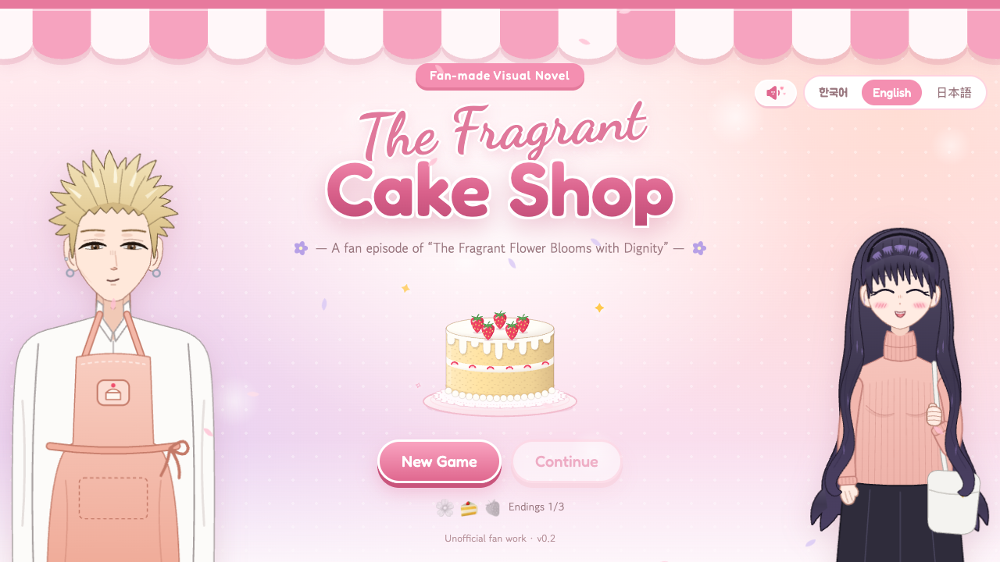

# 🍰 The Fragrant Cake Shop 🍓

**향기로운 케이크 가게 · 薫るケーキ屋さん**

*A tiny, sweet fan visual novel about your first day at a cake shop —<br/>
based on 「薫る花は凛と咲く」 / “The Fragrant Flower Blooms with Dignity”.*


🌸 **No image files for the art** — every character, background and cake is drawn in SVG code 🌸<br/>
🎵 **No audio files either** — the music is composed as data and played by a tiny synth 🎵

</div>

---

## 🧁 What is it?

It's your first shift at **Patisserie Plain**, a little cake shop right by the wall between Chidori High and Kikyo Girls’ High.
Behind the counter is **Rintaro**, tall, blond, a bit scary-looking and secretly the gentlest person ever.
Through the door bounces **Kaoruko**, the shop’s biggest fan, who agrees to taste-test the very first cake you make. 🎂

- 💬 Talk, pick your words and grow closer to both of them (watch for the little 💗 / ⭐ pops!)
- 🎂 Bake a real cake in a five-step minigame: sponge → bake → cream → decorate → serve
- 🌅 Walk Kaoruko home at sunset and find out what a wall between two schools really means
- 🌸 Three endings to collect, saved in your browser
- 🌏 Switch between **English, 한국어 and 日本語** at any time, even mid-sentence

<div align="center">
<table>
  <tr>
    <td>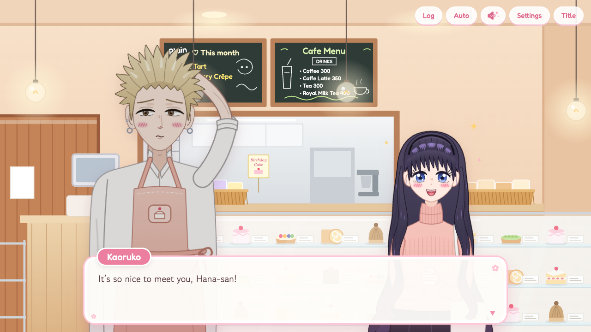</td>
    <td>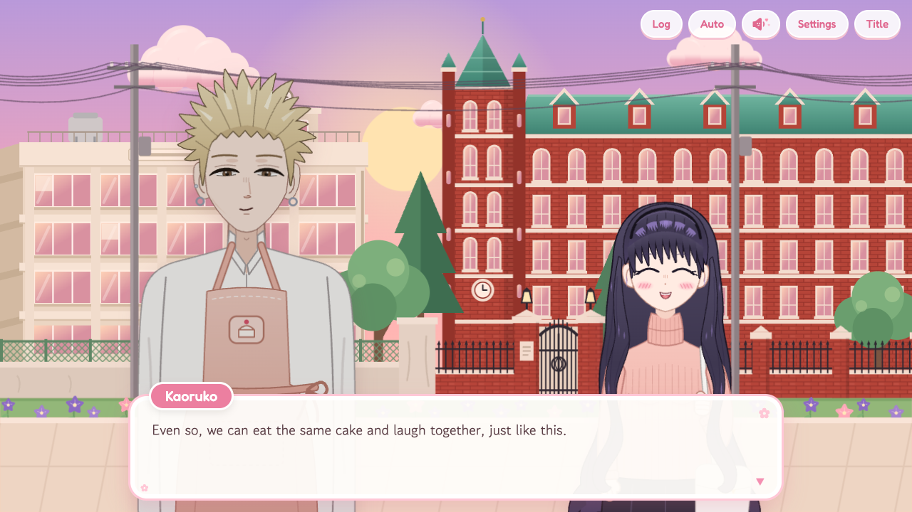</td>
  </tr>
  <tr>
    <td align="center"><sub>☕ Meeting Kaoruko at the shop</sub></td>
    <td align="center"><sub>🌅 The walk home along the wall</sub></td>
  </tr>
</table>
</div>

## 🚀 Play it locally

```bash
npm install
npm run dev        # → http://localhost:5173
npm run build      # typecheck + production build → dist/
npm run preview    # serve the built game
```

It's a static site, so `dist/` can go anywhere. On **Vercel**, import the repo and keep the detected *Vite* settings; every push to `main` redeploys.

---

## 🎂 The cake minigame

Five little steps, with Rintaro cheering you on (and gently consoling you when it burns 🔥).

| | Step | What you do |
|:-:|---|---|
| 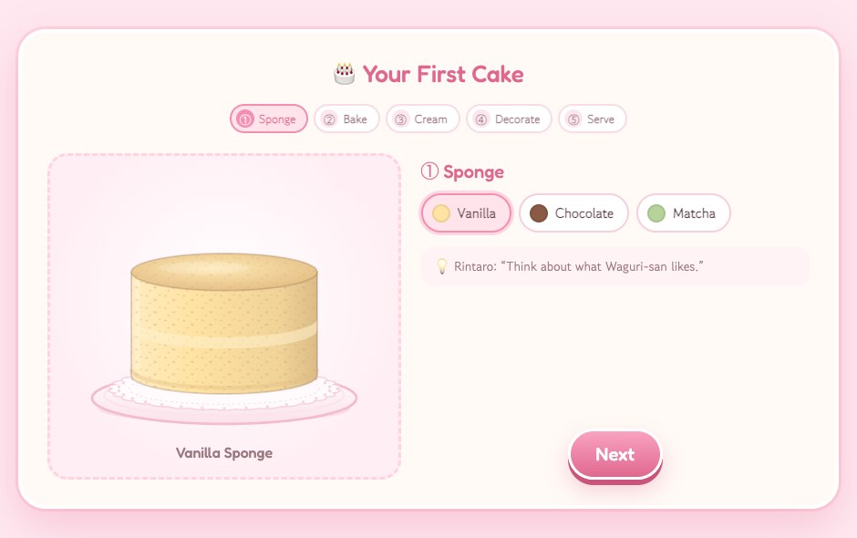 | **① Sponge** | Pick vanilla, chocolate or matcha. *Hint: think about what Kaoruko likes…* |
| 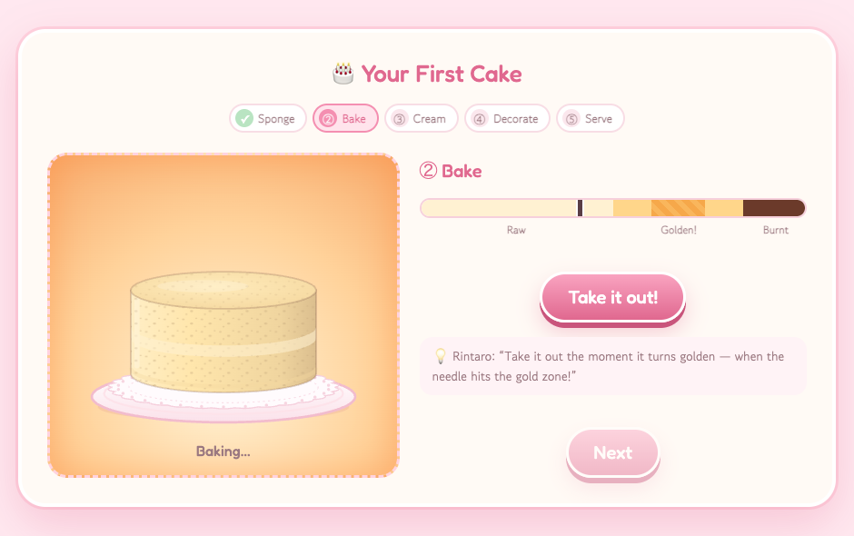 | **② Bake** | The oven glows and a needle creeps from *Raw* to *Burnt*. Take it out in the **golden** zone! |
| 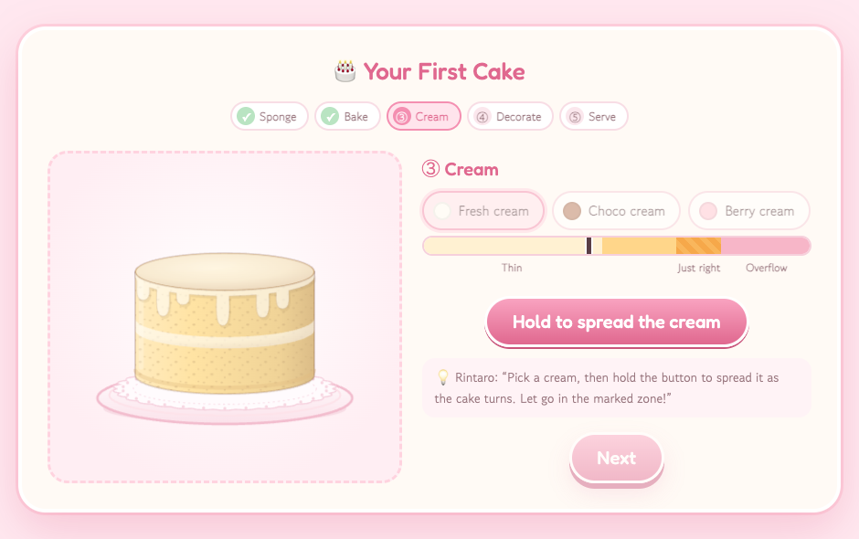 | **③ Cream** | **Hold** the button (or <kbd>Space</kbd>) while the cake spins on its turntable, and let go in the *Just right* zone. |
| 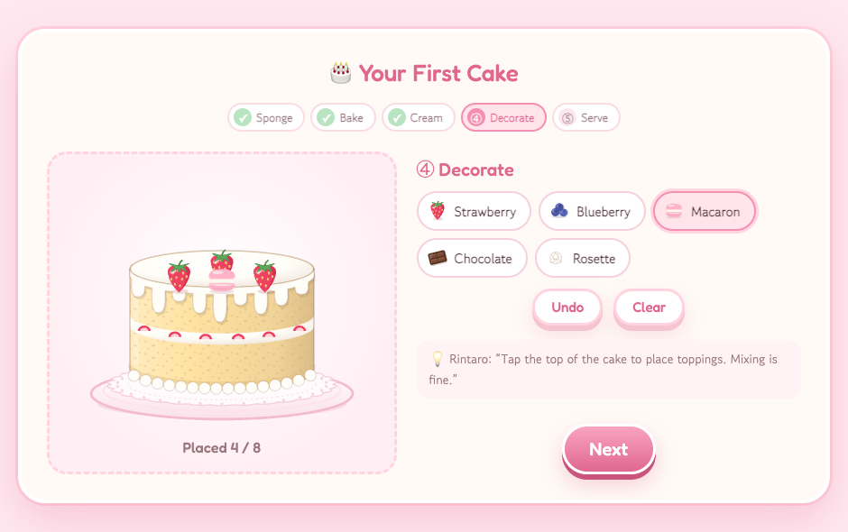 | **④ Decorate** | Tap the top of the cake to place strawberries, blueberries, macarons, chocolate and piped rosettes (up to 8). |
| 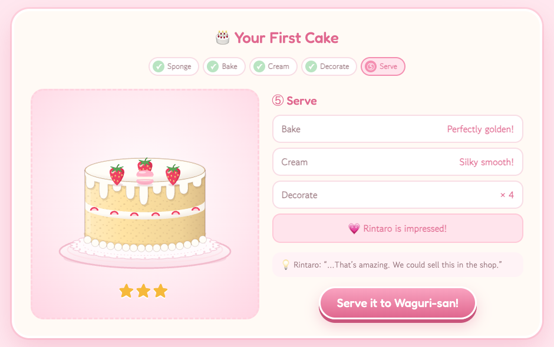 | **⑤ Serve** | Get your ⭐ rating and serve it to Kaoruko! |

Two separate things are scored 🍓

- **How well it's made → ⭐ 1–3 stars.** Golden bake = 2, smooth cream = 2, anything in between = 1, raw / burnt / thin = 0, plus 1 for three or more toppings. **5+ → ⭐⭐⭐** (and Rintaro is impressed: +1 ⭐ with him), **3–4 → ⭐⭐**, otherwise ⭐.
- **Whether it's her favourite.** Kaoruko adores a *vanilla sponge with fresh cream and strawberries on top*. Matching all three wins her heart (+2 💗), two gets +1 💗.

Then the story reacts to *both*: she tastes it, and then they talk about how it looks. A wobbly one-star cake gets
“*Everyone’s like that at first. We all make mistakes*”, plus a secret about Rintaro’s first day. 🤫

## 🌸 Endings

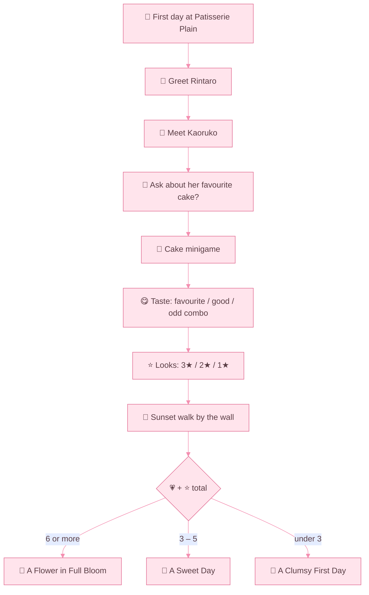

| Ending | How to get it |
|---|---|
| 🌸 **A Flower in Full Bloom** | Be warm with both of them, ask Rintaro what she likes, and bake her favourite as a ⭐⭐⭐ cake. |
| 🍰 **A Sweet Day** | Somewhere in the middle: a friendly chat and a pretty good cake. |
| 🍓 **A Clumsy First Day** | Stay shy, keep secrets and bake her a *creative* cake. Two points are unavoidable, so dodge every other one! |

<div align="center">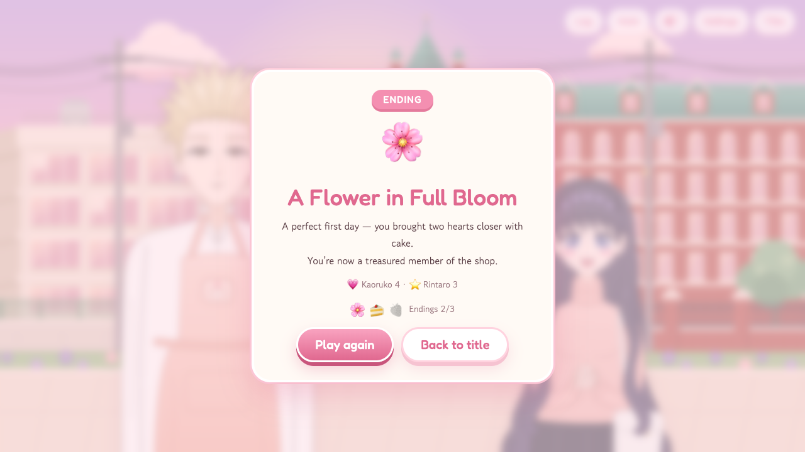</div>

---

## 🎨 Behind the scenes

### 👩‍🎨 Characters: drawn entirely in code

Both characters are React components that return one SVG. There are no PNGs, so they stay crisp at any size.

<div align="center">
<br/>
<sub><b>Rintaro</b>: normal · smile · happy · surprised · blush · troubled</sub>
<br/><br/>
<br/>
<sub><b>Kaoruko</b>: normal · smile · happy · surprised · blush · in her Kikyo uniform</sub>
</div>

<br/>

**How a sprite is put together** (`src/characters/`)

- 📐 Every sprite lives on a **200 × 380 canvas** with the face centred on `x = 100`.
- 🪞 Eyes, brows, ears and hair locks are drawn **once on the left** and mirrored with `<Mirror>` / `flip()`, so faces are perfectly symmetric.
- ✒️ `<Inked>` draws every outline first and every fill on top, so overlapping shapes (like Kaoruko's hair) get **one clean outer outline** instead of a tangle of lines.
- 💪 `<Limb>` draws arms as thick round strokes with an outline. `lock()` generates bangs and hair strands from a base, tip and bend.
- 😊 Each **expression** swaps eyes, brows, mouth and blush, and adds little effects through `<Fx>`: ✨ sparkles when happy, 💧 a sweat drop when troubled, and surprise lines.
- 🙆 Expressions can change the **pose** too:
  - Rintaro scratches the back of his head when he's flustered.
  - Kaoruko clasps her hands when she's excited.
  - Kaoruko has two outfits: a casual sweater with a shoulder bag, and the Kikyo uniform.

| Piece | Layers, back to front |
|---|---|
| 🧍 Body | back hair → torso & outfit → arms & hands |
| 🙂 Head | ears & earrings → face → blush → eyes / brows / nose / mouth → bangs, headband & highlights |

### ✨ Animations

Everything moves a little, so the characters feel alive:

| Animation | How it works |
|---|---|
| 👀 **Blinking** | `useBlink()` blinks every 2.2–5.4 s at random, and 1 in 4 times it's a quick double blink. |
| 💬 **Talking** | The mouth flaps open and closed every 130 ms while the text types out. |
| 🫁 **Breathing** | `.breathe` scales the body by ~1.5 % over 3.6 s; `.headbob` tilts the head half a degree on the same beat. |
| 🦘 **Reacting** | When an expression changes, the sprite does a tiny 14 px **hop** (motion). |
| 🚶 **Entering / leaving** | Characters fade and rise in, then sink out. Whoever isn't speaking is dimmed. |
| 🌸 **Scenery** | Flags and flowers `sway`, lamps `glow`, clouds `drift`, sparkles `twinkle`, and petals drift down across the screen. |
| 🎂 **Title screen** | The cake floats, bokeh lights wander and the bellflowers slowly spin. |
| 🔥 **Minigame** | The oven glows orange while baking, and the cake wobbles on its turntable while you hold the cream button. |
| ⌨️ **Text** | A typewriter reveals each line, with little *blips*: low for Rintaro, high for Kaoruko. |
| ♿ **Reduced motion** | If your system asks for less motion, all of the above politely stops. |

> 💡 The two sprite sheets above are SVG files with the sprites' own CSS animations inside, so they breathe on GitHub too.

### 🏙️ Backgrounds

Four hand-coded SVG scenes in `src/backgrounds/`:
- the **street by day** with fluffy gradient clouds;
- the **same street at sunset**;
- the **shop front** under its blue awning;
- the **shop inside**, with chalkboard menus, hanging lamps and a showcase full of cakes.

### 🎵 Music & sound

`src/audio/` is a small **Web Audio synth**, so there's not a single sound file.

- 🎼 **Two original songs** are written as data in `tracks.ts`, with chords, a bass line and a melody like `'A5 . C6 . A5 G5 F5 .'`:
  - *“Cake Shop Waltz”*: F major, 100 bpm, music-box lead, for the shop;
  - *“Across the Wall”*: C major, 76 bpm, slow and warm, for the sunset.
- 🔔 **Sound effects** are built from oscillators:
  - the door bell's *ding-a-ling*;
  - a music-box chime when you choose;
  - a sparkle when hearts pop;
  - a fanfare for your cake;
  - a soft chord for each ending.
- 🎚️ Music, sound effects and text blips each have their own volume in Settings, plus a mute button.

### 📖 Story engine

- `src/engine/game.ts` is a small **reducer** that walks through the script one step at a time:
  - `say` — a line of dialogue;
  - `choice` — a set of options;
  - `show` / `hide` — characters on and off screen;
  - `bg` — a background change;
  - `branch` — a jump picked from your points;
  - `cake` — the minigame;
  - `ending`.
- 💾 It autosaves after every step, keeps a **backlog** and has an **Auto** mode that waits longer for longer lines.
- 🏷️ Every jump target is declared in a `LABELS` list, so a typo is a **type error** instead of a broken game.
- 🌏 Every piece of text is a `{ ko, en, ja }` object, and TypeScript refuses to build if a translation is missing.
- 🔤 Each language gets its own fonts:
  - Fredoka & Dancing Script for English titles;
  - Jua & Gowun Dodum for Korean;
  - Kiwi Maru & Zen Maru Gothic for Japanese, since the Korean fonts have no kana.

---

## 🗂️ Where things live

| Path | What |
|---|---|
| `src/story/chapter1.ts` | 📜 The script: every line in `ko` + `en` + `ja`, choices, branches, endings |
| `src/story/cake.ts` | 🎂 Cake ingredients, Kaoruko's favourite, minigame scoring and Rintaro's tips |
| `src/story/cast.ts` | 👥 Character names & colours, ending titles |
| `src/engine/` | ⚙️ Story reducer, saving, typewriter, settings |
| `src/characters/` | 👩‍🎨 SVG sprites: `Rintaro.tsx`, `Kaoruko.tsx`, shared drawing helpers in `parts.tsx`, blinking & talking in `CharacterSprite.tsx` |
| `src/backgrounds/` | 🏙️ SVG scenes: street (day & sunset), shop front, shop |
| `src/components/` | 🧩 Dialogue box, choices, cake minigame (`CakeBuilder.tsx`, `Cake.tsx`), title & ending screens |
| `src/audio/` | 🎵 Web Audio synth (`audio.ts`) and the songs (`tracks.ts`) |
| `src/i18n.tsx` | 🌏 UI strings and the language switch |
| `docs/` | 📸 Images for this README |
| `legacy/index.html` | 🗃️ The original single-file draft |

## ✍️ Writing story

Lines are written with small helpers in `chapter1.ts`:

```ts
K('happy', '한국어 대사', 'English line', '日本語のセリフ'),   // Kaoruko speaks (expression, ko, en, ja)
R('blush', '…', '…', '…'),                                   // Rintaro speaks
N('나레이션', 'Narration', 'ナレーション'),                      // narration
Q({ ko: '질문', en: 'Question', ja: '質問' }, [
  opt('선택지', 'Option', '選択肢', 'someLabel', { k: 1 }),     // +1 💗 Kaoruko (use r for ⭐ Rintaro)
]),
```

`{name}` and `{cakeName}` are filled in automatically: the cake's name is built from what you baked, in each language's own grammar.

## 🧪 Dev previews

Only available while running `npm run dev`:

| URL | Shows |
|---|---|
| `/#sprites` | Every character × every expression (`#sprites=600:kao` → one character, bigger) |
| `/#bg=streetDay` | A single background (`street`, `shopFront`, `shop`) |
| `/#cake` | The cake minigame on its own |

---

<div align="center">

 

💌 **An unofficial, non-commercial fan work.**<br/>
「薫る花は凛と咲く」 (*The Fragrant Flower Blooms with Dignity*) and its characters belong to **Saka Mikami** and Kodansha.<br/>
All art, music and code in this repo were made from scratch for this fan game.

*Made with 🍓 and a lot of whipped cream.*

</div>
